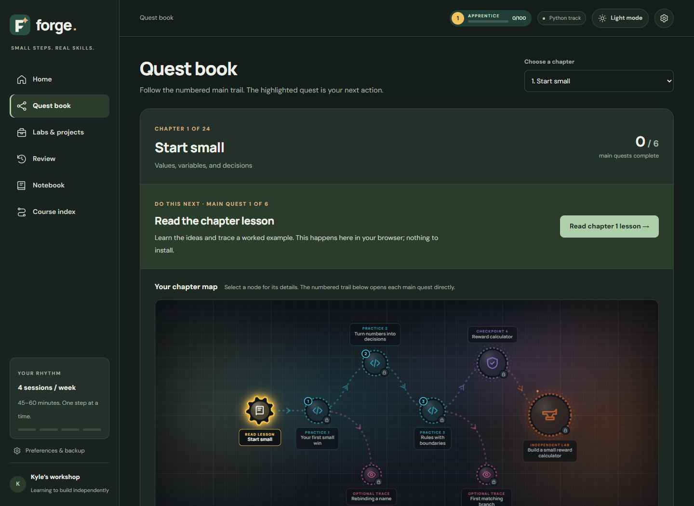
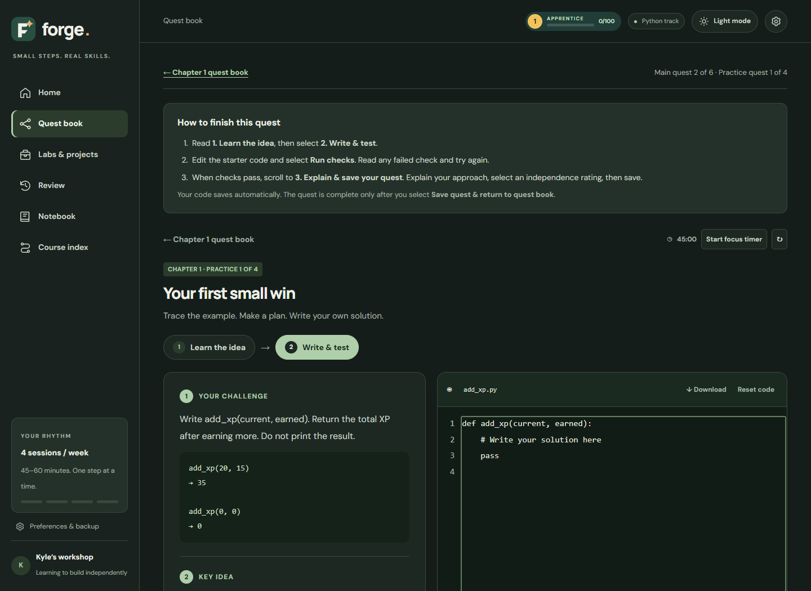
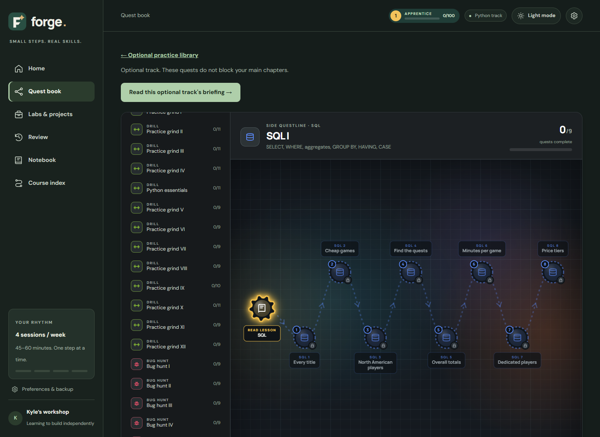
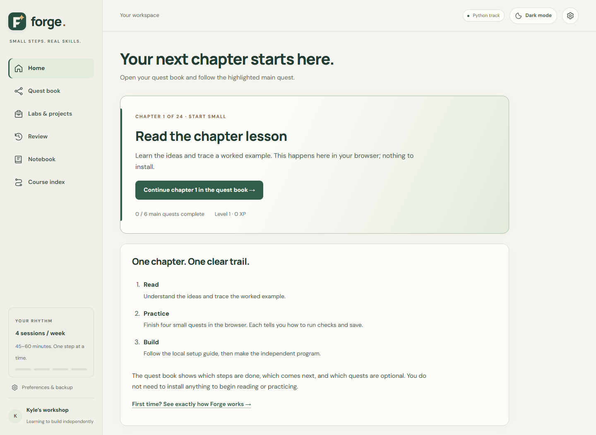
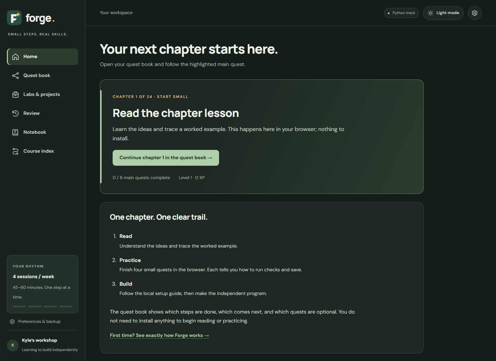

# Forge

A gamified Python and SQL practice app that runs entirely in the browser. Learners move through a quest map, write real code, and get graded by automated checks. The live demo needs no install or account, and learner code never runs on a server. Local independent labs use Python and VS Code on the learner's own computer.

**[Try the live demo](https://kyle-goodman-cs.github.io/forge/)**



## What it does

- **Quest book and XP:** a 24-chapter course with a map, a highlighted next action, and a six-quest main trail: reading, four browser practice quests, and an independent local lab. Optional traces and practice tracks do not block main progress. Clearing work solo earns full XP; using help earns less.
- **Beginner guidance:** explicit reading completion, clear Learn / Write & test / Explain & save steps, and a checklist showing what is required to save a quest.
- **Guided local labs:** one setup step at a time, platform-specific commands, correct chapter downloads, and live acceptance/evidence feedback.
- **Comfortable reading:** soft light and dark themes, system appearance support, stronger typography and contrast, plus an original F-and-ember logo and multi-resolution desktop icon.
- **Earned-hint system:** hints aren't free. The first unlocks after two failed runs with new code, the second after one more, and each needs a written diagnosis first. The full solution also needs a 20-minute wait, pays 0 XP, and creates a redo bounty 48 hours later.
- **Spaced review:** finished lessons come back on a schedule, to be rebuilt from a blank page.
- **In-browser Python:** learner code runs in a disposable Web Worker on Pyodide (Python 3.12 compiled to WebAssembly), so a stuck program can be killed without freezing the page.
- **SQL track with dual-dataset grading:** every query runs against two different databases, so hard-coding the expected rows can't pass.
- **Predict, then run:** learners call pass or fail for each check before running it, and earn bonus XP for reading code correctly.

| Lesson view | SQL questline |
|---|---|
|  |  |

## Light and dark themes

| Soft light | Charcoal green |
|---|---|
|  |  |

Use the top-right theme button, or select System, Light, or Dark in Settings. The choice stays separate from learning progress.

## By the numbers

- 317 lessons: 96 core sessions and 221 questline quests (drills, bug hunts, SQL, interview problems, hardware logic)
- 1,345 automated checks
- 48 "predict the output" trace quests
- 24 weekly handbooks and 24 downloadable lab kits

## My role

I defined the goals and learning approach, and chose and prioritized the features: quest-map progression, the earned-hint ladder, questlines, and the SQL track with dual-dataset grading. I directed the visual design, reviewed the output, and set the quality bar through automated checks and browser testing. The code was written with AI coding tools.

## How it was built

I designed the product and its learning mechanics: the progression, the earned-help rules, the XP economy, and the grading approach. I built it with AI coding tools (ChatGPT/Codex and Claude Code).

Because AI wrote much of the code, I treated verification as a core part of the project:

- **1,345 automated checks** run in the real bundled Python interpreter, using `checks/verify-course.cjs`, which also runs every teaching example and renders 426 app routes in a simulated DOM.
- **Mutation testing:** the checks are themselves tested against deliberately broken code, and cases were added where a mutant survived.
- **Browser playthroughs** in a real browser, since a simulated DOM can't catch everything.
- **Build-time guards:** expected answers are generated by running reference solutions, never typed by hand. The build fails if a bug-hunt starter passes or if the two SQL datasets give identical results.

This repo is a public snapshot of a private development repo, so its history starts here.

## Tech

- **Frontend:** vanilla JavaScript, HTML, and CSS, with no framework and no frontend build step
- **Python runtime:** Pyodide 0.27.7 / WebAssembly, with SQLite, inside Web Workers
- **Content:** Python generators in `content/` produce the curriculum, handbooks, labs, and trace quests
- **Verification:** a Node.js script that runs every check and route
- **Hosting:** GitHub Pages, deployed from `dist/` by GitHub Actions

## Run it locally

```bash
python3 serve.py --open         # Windows: py serve.py --open
```

This serves `dist/` at http://127.0.0.1:8000. `Start Forge.bat` and `Start Forge.command` do the same with a double-click. On Windows, run `Create desktop shortcut.bat` to create or refresh a Forge shortcut using the current F-and-ember logo. Older `forge.ico` shortcuts keep a matching icon.

Start with **Home -> Quest book -> Do this next**. Settings offers System, Light, and Dark themes. Before the first local lab, follow its guided setup; no tools are required for browser reading and practice.

To rebuild the content and run the checks:

```bash
python3 content/build_course.py
node checks/verify-course.cjs
```

Progress is saved in your browser's local storage, so it stays on your device. Use the export in Settings to back it up.

## License

Forge is released under the [MIT License](LICENSE). The bundled runtime in `dist/python/` (Pyodide, CPython, SQLite) keeps its own licenses.
